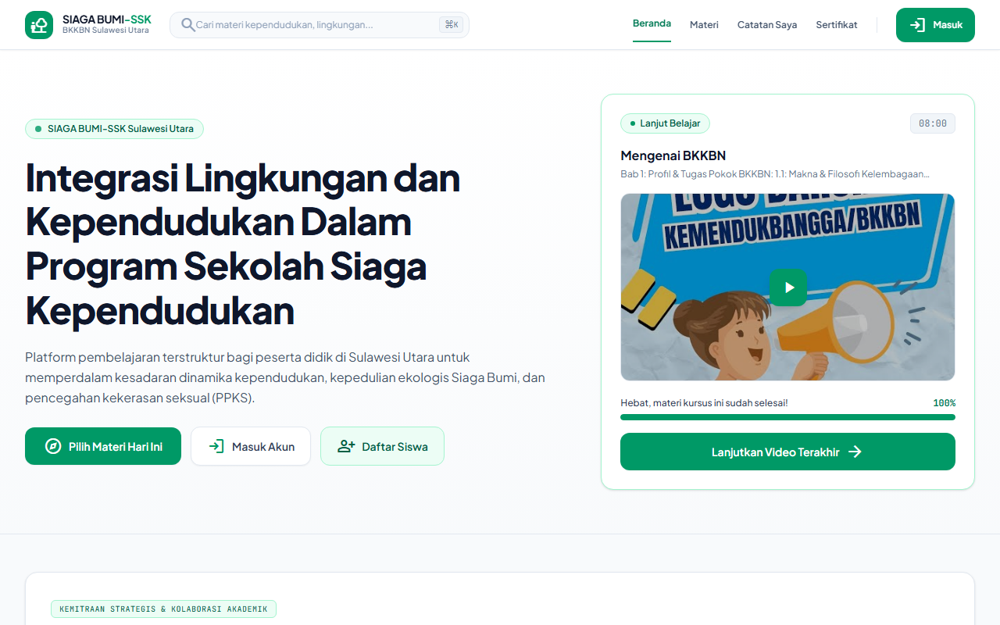
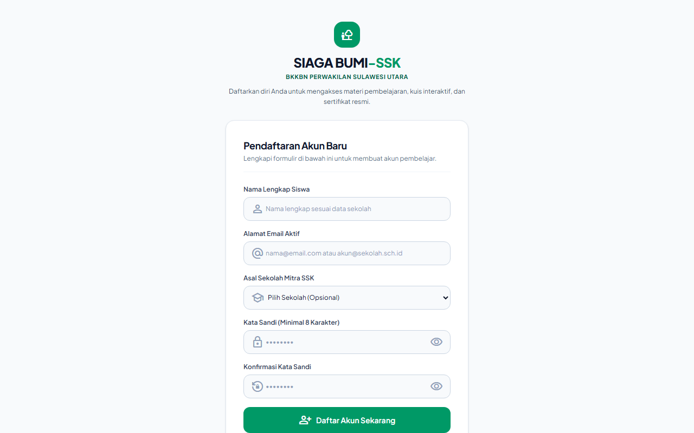
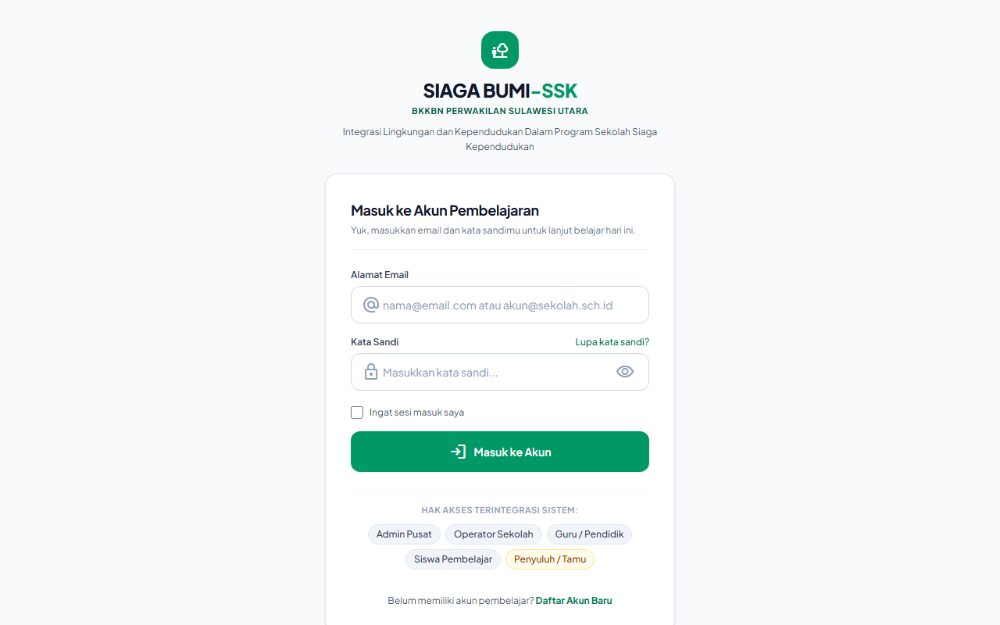
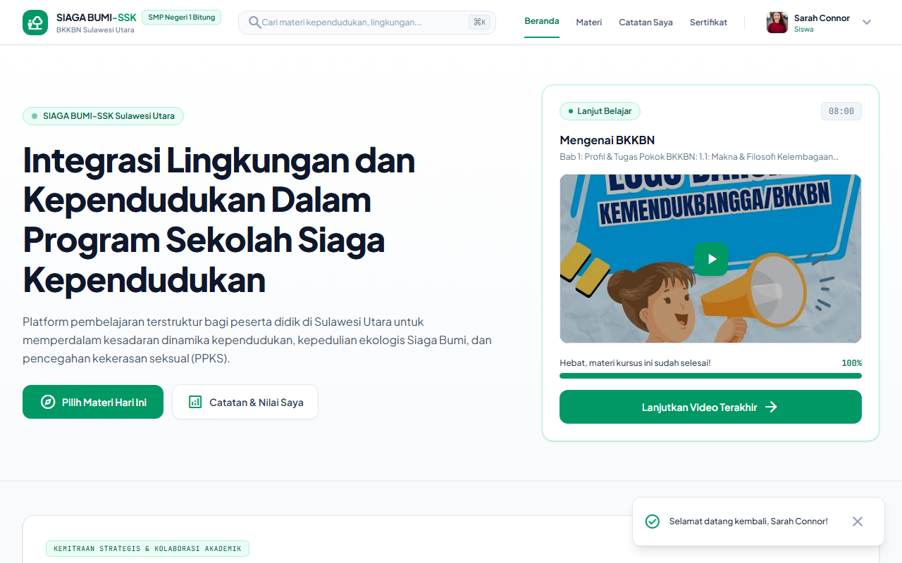
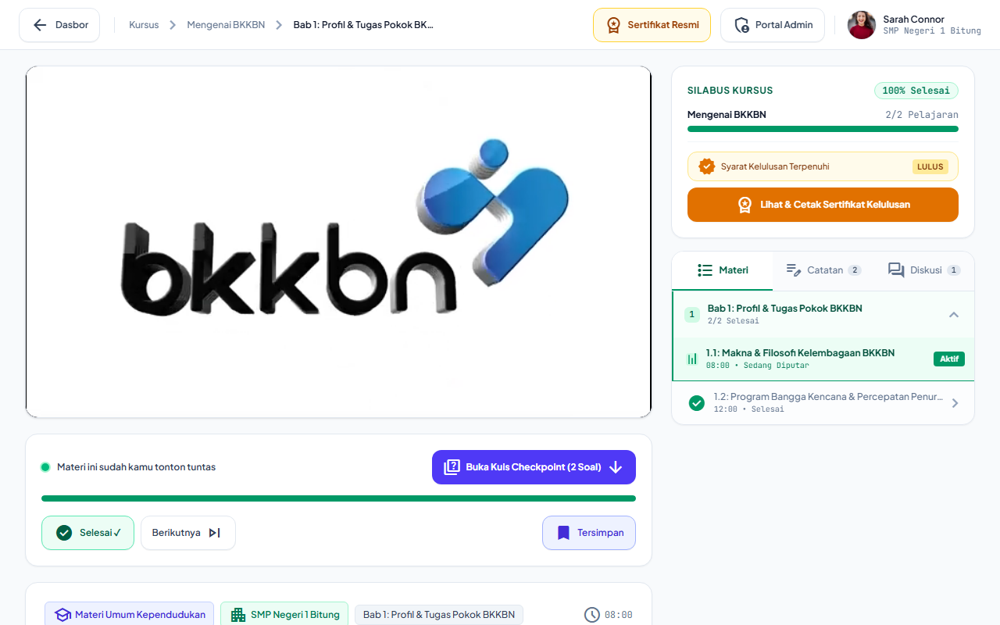
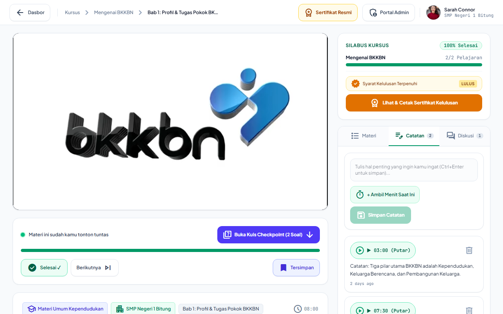
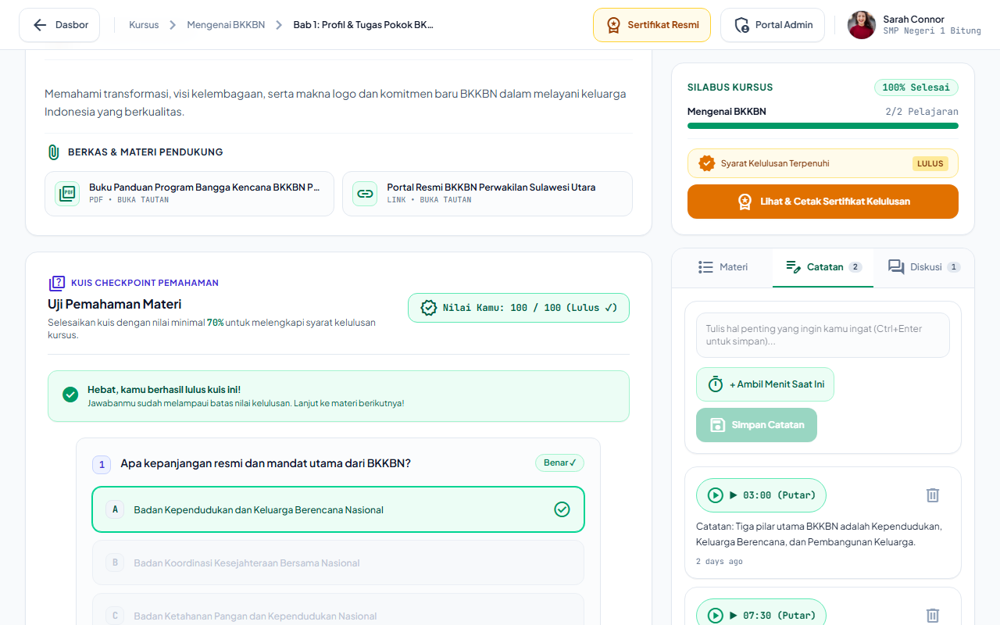
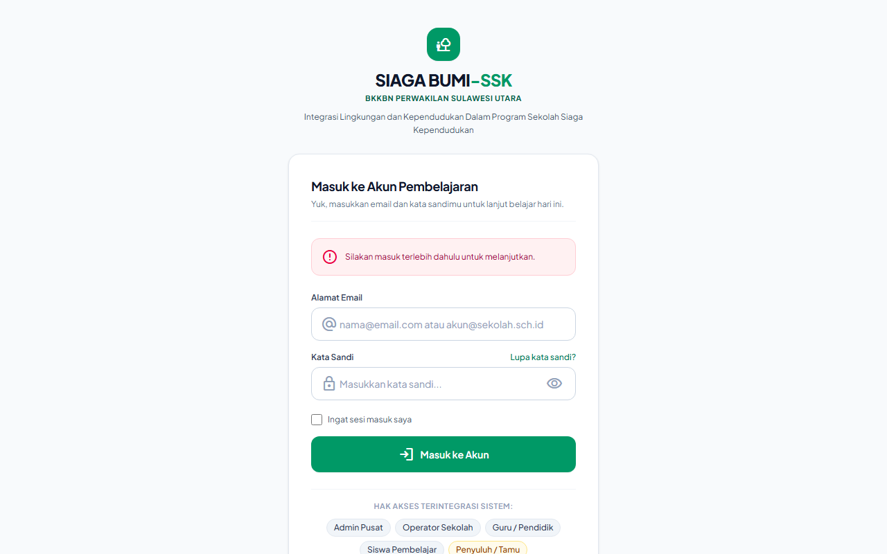
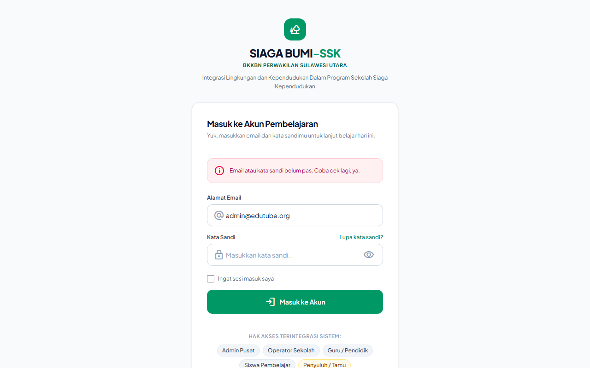
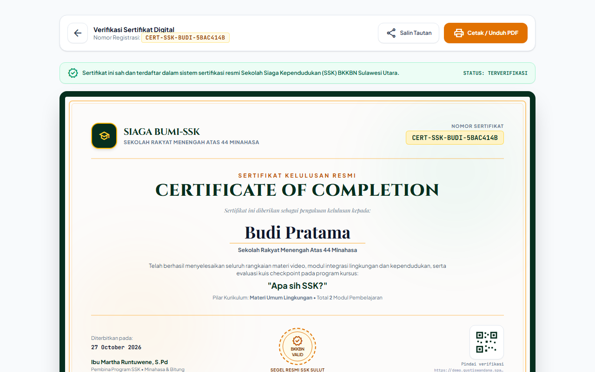

# BUKU PANDUAN PENGGUNA (MANUAL BOOK)
# PLATFORM LMS "SIAGA BUMI-SSK"
### Integrasi Lingkungan dan Kependudukan Dalam Program Sekolah Siaga Kependudukan
**BKKBN Perwakilan Provinsi Sulawesi Utara**  
*Bekerja sama dengan UNIMA, UNPI, dan IPDN Kampus Sulawesi Utara*

---

## DAFTAR ISI
1. [PENDAHULUAN & GAMBARAN UMUM](#1-pendahuluan--gambaran-umum)
   - 1.1 Mengenai SIAGA BUMI-SSK
   - 1.2 Pilar Kurikulum & Ruang Lingkup Materi
   - 1.3 Sekolah Mitra Percontohan (Pilot Schools)
   - 1.4 Matriks Hak Akses Pengguna (Role-Based Access Control / RBAC)
2. [AKSES & AUTENTIKASI PENGGUNA](#2-akses--autentikasi-pengguna)
   - 2.1 Pendaftaran Mandiri Siswa Baru (`/register`)
   - 2.2 Masuk ke Akun Pembelajaran (`/login`)
   - 2.3 Fitur Intip Kata Sandi (*Password Eye Toggle*)
   - 2.4 Daftar Akun Pengujian & Kredensial Resmi
   - 2.5 Lupa Kata Sandi & Bantuan Akses
3. [PANDUAN SISWA PEMBELAJAR (`siswa`)](#3-panduan-siswa-pembelajar-siswa)
   - 3.1 Dasbor Pembelajaran & Satu Aksi Utama
   - 3.2 Menjelajahi Katalog Kursus Berdasarkan Pilar
   - 3.3 Teater Belajar & Pemutar Video Terintegrasi (Classroom)
   - 3.4 Live Watch Completion Tracker (Ambang 90%)
   - 3.5 Catatan Waktu Interaktif (*Timestamp Notes*) & Pintasan Cepat
   - 3.6 Forum Diskusi Materi Antarsiswa & Guru
   - 3.7 Mengerjakan Kuis Checkpoint & Umpan Balik Nilai
   - 3.8 Klaim dan Cetak E-Sertifikat Kelulusan
4. [PANDUAN GURU / PENDIDIK (`guru`)](#4-panduan-guru--pendidik-guru)
   - 4.1 Mengakses Ruang Kerja Pendidik
   - 4.2 Menyusun Kursus dengan Unified Course Builder
   - 4.3 Menambahkan Modul & Mengintegrasikan Video YouTube
   - 4.4 Merancang Kuis Checkpoint, Kunci Jawaban & Pembahasan
   - 4.5 Memantau Perkembangan & Nilai Evaluasi Siswa
   - 4.6 Batasan Keamanan Hak Akses Guru
5. [PANDUAN OPERATOR SEKOLAH (`operator_sekolah`)](#5-panduan-operator-sekolah-operator_sekolah)
   - 5.1 Dasbor Sekolah & Statistik Satuan Pendidikan
   - 5.2 Mendaftarkan Siswa Baru Secara Satuan
   - 5.3 Pendaftaran Masal Siswa Menggunakan Template CSV
   - 5.4 Mengatur Ulang (*Reset*) Kata Sandi Akun Siswa
   - 5.5 Memverifikasi Status Kelulusan Siswa Per Kelas
6. [PANDUAN ADMIN PUSAT (`admin_pusat` / `super_admin`)](#6-panduan-admin-pusat-admin_pusat--super_admin)
   - 6.1 Dasbor Analitik Tingkat Provinsi BKKBN
   - 6.2 Manajemen Master Data Sekolah Mitra
   - 6.3 Manajemen Akun Operator & Pengguna Lintas Sekolah
   - 6.4 Kurasi Akses Mode Galeri untuk Tamu (`is_visible_to_guest`)
   - 6.5 Pemeriksaan Kesehatan Tautan Video YouTube (*Video Health Check*)
   - 6.6 Pengaturan Kebijakan Sistem Global
   - 6.7 Manajemen Tiket Bantuan & Dukungan Teknis
7. [PANDUAN PENYULUH & TAMU (`penyuluh` - MODE GALERI)](#7-panduan-penyuluh--tamu-penyuluh---mode-galeri)
   - 7.1 Karakteristik Akses Mode Galeri (*View-Only*)
   - 7.2 Materi Terpilih untuk Penyuluhan Lapangan
   - 7.3 Batasan Hak Akses Mode Galeri
8. [SISTEM SERTIFIKASI DIGITAL & VERIFIKASI QR CODE](#8-sistem-sertifikasi-digital--verifikasi-qr-code)
   - 8.1 Komponen Keamanan Sertifikat Digital
   - 8.2 Prosedur Verifikasi Keaslian Melalui QR Code
   - 8.3 Laman Verifikasi Publik (`/sertifikat/{kode}`)
   - 8.4 Format Cetak & Ekspor PDF Beresolusi Tinggi
9. [PUSAT BANTUAN & TANYA JAWAB (FAQ)](#9-pusat-bantuan--tanya-jawab-faq)

---

## 1. PENDAHULUAN & GAMBARAN UMUM

### 1.1 Mengenai SIAGA BUMI-SSK
**SIAGA BUMI-SSK (Sekolah Siaga Kependudukan)** adalah platform manajemen pembelajaran digital (*Learning Management System / LMS*) yang dirancang khusus untuk mengintegrasikan pendidikan wawasan kependudukan, pelestarian lingkungan hidup, serta pencegahan dan penanganan kekerasan seksual ke dalam jenjang pendidikan sekolah menengah.

Platform ini diinisiasi oleh **BKKBN Perwakilan Provinsi Sulawesi Utara** bersama konsorsium perguruan tinggi dan lembaga kedinasan:
1. **Universitas Negeri Manado (UNIMA)** — Penyusunan kurikulum pedagogis dan evaluasi pembelajaran kependudukan.
2. **Universitas Pembangunan Indonesia (UNPI)** — Pengembangan teknologi, infrastruktur digital, dan arsitektur sistem.
3. **Institut Pemerintahan Dalam Negeri (IPDN) Kampus Sulawesi Utara** — Wawasan kepamongprajaan, ketahanan sosial, dan tata kelola masyarakat.
4. **BKKBN Perwakilan Sulawesi Utara** — Regulasi program Bangga Kencana, penyuluhan GenRe, dan koordinasi Sekolah Siaga Kependudukan.


*Gambar 1.1: Tampilan Beranda Utama SIAGA BUMI-SSK dengan kurasi 3 pilar kurikulum resmi, panduan belajar terarah, serta logo konsorsium BKKBN, UNIMA, UNPI, dan IPDN.*

### 1.2 Pilar Kurikulum & Ruang Lingkup Materi
Kurikulum pembelajaran dalam SIAGA BUMI-SSK distandarisasi ke dalam 3 (tiga) pilar tematik utama:

```
┌─────────────────────────────────────────────────────────────────────────┐
│                    KURIKULUM RESMI SIAGA BUMI-SSK                       │
├───────────────────┬─────────────────────────┬───────────────────────────┤
│ 1. KEPENDUDUKAN   │ 2. LINGKUNGAN HIDUP     │ 3. PPKS                   │
│    (GenRe & BKKBN)│    (Siaga Bumi)         │    (Perlindungan Remaja)  │
├───────────────────┼─────────────────────────┼───────────────────────────┤
│ • Pengenalan BKKBN│ • Krisis Iklim Global   │ • Pencegahan Kekerasan    │
│ • Bonus Demografi │ • Konservasi Endemik    │   Seksual di Sekolah      │
│ • GenRe & 8 Fungsi│   Sulawesi Utara        │ • Batasan Tubuh Pribadi   │
│   Keluarga        │ • Bank Sampah Sekolah   │ • Kanal Aduan & Hak Anak  │
│ • Penundaan Usia  │ • Penghijauan & Sumber  │ • Pendampingan Korban     │
│   Perkawinan      │   Daya Air Minahasa     │   & Sahabat Sebaya        │
└───────────────────┴─────────────────────────┴───────────────────────────┘
```

Setiap pilar memiliki identitas visual yang konsisten:
- **Pilar Kependudukan (GenRe):** Aksen warna Indigo (`#4F46E5`).
- **Pilar Lingkungan (Siaga Bumi):** Aksen warna Emerald (`#059669`).
- **Pilar PPKS (Perlindungan Diri):** Aksen warna Rose Terracotta (`#E11D48`).
- **Lencana Resmi & Kelulusan:** Aksen warna Emas Kelembagaan / Amber (`#F59E0B`).

### 1.3 Sekolah Mitra Percontohan (Pilot Schools)
Seluruh materi, siswa, dan administrasi operasional saat ini dipusatkan pada 2 (dua) sekolah mitra resmi di Sulawesi Utara:
1. **SMP Negeri 1 Bitung**  
   - NPSN: `40101511`  
   - Alamat: *Jl. Sam Ratulangi No. 12, Pakadoodan, Madidir, Kota Bitung, Sulawesi Utara*
2. **Sekolah Rakyat Menengah Atas 44 Minahasa**  
   - NPSN: `40104444`  
   - Alamat: *Jl. Raya Tanawangko No. 44, Tombariri, Kabupaten Minahasa, Sulawesi Utara*

### 1.4 Matriks Hak Akses Pengguna (Role-Based Access Control / RBAC)
Sistem membedakan wewenang ke dalam 5 (lima) peran terpisah dengan pengamanan ketat:

| Fitur / Modul | Admin Pusat (`admin_pusat`) | Operator Sekolah (`operator_sekolah`) | Guru / Pendidik (`guru`) | Siswa Pembelajar (`siswa`) | Penyuluh / Tamu (`penyuluh`) |
| :--- | :---: | :---: | :---: | :---: | :---: |
| **Katalog Kursus Publik** | Ya | Ya | Ya | Ya | Ya (Materi Terpilih) |
| **Ruang Belajar & Video** | Ya | Ya | Ya | Ya | Ya (Lihat-Saja) |
| **Catatan Timestamp Pribadi** | Tidak | Tidak | Tidak | Ya | Tidak |
| **Mengerjakan Kuis Checkpoint** | Tidak | Tidak | Tidak | Ya | Tidak |
| **Menerima E-Sertifikat** | Tidak | Tidak | Tidak | Ya | Tidak |
| **Unified Course Builder** | Ya | Tidak | Ya | Tidak | Tidak |
| **Manajemen Master Soal** | Ya | Tidak | Ya | Tidak | Tidak |
| **Manajemen Siswa & CSV** | Ya (Semua) | Ya (Sekolahnya) | Tidak | Tidak | Tidak |
| **Reset Sandi Siswa** | Ya | Ya (Sekolahnya) | Tidak | Tidak | Tidak |
| **Master Data Sekolah** | Ya | Tidak | Tidak | Tidak | Tidak |
| **Kurasi Visibilitas Tamu** | Ya | Tidak | Tidak | Tidak | Tidak |
| **Pengaturan Global Platform** | Ya | Tidak | Tidak | Tidak | Tidak |

---

## 2. AKSES & AUTENTIKASI PENGGUNA

### 2.1 Pendaftaran Mandiri Siswa Baru (`/register`)
Bagi siswa yang belum memiliki akun dari sekolah, pendaftaran mandiri dapat dilakukan secara gratis dan langsung aktif:
1. Buka peramban pada ponsel atau komputer dan kunjungi tautan:  
   **`https://demo.gustiswandana.space/register`** (atau klik tautan **Daftar Siswa** di bilah navigasi atas).
2. Isi formulir dengan data yang benar:
   - **Nama Lengkap**: Masukkan nama lengkap sesuai kartu pelajar (nama ini akan dicetak otomatis pada sertifikat).
   - **Asal Sekolah**: Pilih antara *SMP Negeri 1 Bitung* atau *Sekolah Rakyat Menengah Atas 44 Minahasa*.
   - **Alamat Domisili**: Cantumkan kota/wilayah domisili Anda di Sulawesi Utara.
   - **Alamat Email**: Email aktif milik siswa.
   - **Nomor HP / WhatsApp**: Nomor ponsel aktif untuk keperluan pemberitahuan.
   - **Kata Sandi**: Buat kata sandi minimal 6 karakter.
   - **Konfirmasi Kata Sandi**: Ketik ulang kata sandi yang sama.
3. Klik tombol **Daftar Akun Siswa**. Sistem akan memverifikasi dan langsung mengarahkan Anda ke Dasbor Pembelajaran Siswa tanpa perlu menunggu persetujuan manual.


*Gambar 2.1: Antarmuka formulir registrasi mandiri siswa baru lengkap dengan pemilihan sekolah percontohan resmi di Sulawesi Utara.*

### 2.2 Masuk ke Akun Pembelajaran (`/login`)
1. Buka laman: **`https://demo.gustiswandana.space/login`**.
2. Masukkan alamat email yang sudah terdaftar.
3. Masukkan kata sandi akun Anda.
4. *(Opsional)* Centang kotak **Ingat sesi masuk saya** jika menggunakan perangkat pribadi agar sesi tidak mudah berakhir.
5. Klik tombol hijau **Masuk ke Akun**.
   - Jika berhasil, Anda akan dialihkan otomatis ke antarmuka yang sesuai dengan peran Anda (Admin/Guru ke Dasbor Pengelola, Siswa ke Dasbor Belajar).
   - Jika terdapat kekeliruan data, sistem akan menampilkan pesan peringatan ramah:  
     *"Email atau kata sandi belum pas. Coba cek lagi, ya."*


*Gambar 2.2: Laman masuk akun pembelajaran dengan kontrol intip kata sandi (eye toggle), tombol sentuh lega 48px, dan lencana panduan 5 peran resmi.*

### 2.3 Fitur Intip Kata Sandi (*Password Eye Toggle*)
Untuk menghindari salah ketik kata sandi saat menggunakan ponsel layar sentuh:
- Klik ikon mata (`visibility` / `visibility_off`) di sisi kanan kotak isian kata sandi.
- Teks kata sandi akan terlihat dalam teks terbaca, dan dapat disembunyikan kembali dengan satu kali ketukan.

### 2.4 Daftar Akun Pengujian & Kredensial Resmi
Berikut kredensial default yang telah disiapkan untuk pengujian dan operasional:

| Peran Akun | Alamat Email | Kata Sandi | Keterangan & Akses Satuan |
| :--- | :--- | :--- | :--- |
| **Admin Pusat** | `admin@edutube.org` | `password` | Administrator BKKBN Sulut (Akses Penuh) |
| **Admin Pusat (Alternatif)** | `adminpusat@siagabumi.id` | `password` | Koordinator Teknis Provinsi |
| **Operator Sekolah** | `smkn1@edutube.org` | `password` | Pengelola Administrasi SMPN 1 Bitung |
| **Guru / Pendidik** | `guru.bitung@sekolah.sch.id` | `password` | Pengajar SMP Negeri 1 Bitung |
| **Siswa Pembelajar** | `student@edutube.org` | `password` | Siswa Aktif SMP Negeri 1 Bitung |
| **Siswa Pembelajar (2)** | `alex@student.edutube.org` | `password` | Siswa Mandiri |
| **Penyuluh / Tamu** | `guest@edutube.org` | `password` | Penyuluh Lapangan BKKBN (Mode Galeri) |

### 2.5 Lupa Kata Sandi & Bantuan Akses
- Siswa yang lupa kata sandi dapat menghubungi **Operator Sekolah** masing-masing untuk dilakukan *reset* instan menjadi kata sandi bawaan `password`.
- Untuk bantuan kendala akun lainnya, gunakan tautan *Bantuan & Tiket Pengaduan* yang tersedia di footer aplikasi.

---

## 3. PANDUAN SISWA PEMBELAJAR (`siswa`)

### 3.1 Dasbor Pembelajaran & Satu Aksi Utama
Setelah berhasil masuk, siswa disambut dengan antarmuka yang bersih, lapang, dan ramah:
- **Kartu Lanjutkan Belajar:** Kartu utama menampilkan materi yang terakhir kali Anda buka beserta sisa persentase kelulusan.
- **Satu Aksi Utama:** Cukup klik tombol hijau **Lanjutkan Video Terakhir** untuk langsung kembali ke detik terakhir video yang Anda tonton.
- **Indikator Progres Menyenangkan:** Garis progres linier mengabarkan sisa langkah secara bersahabat, contohnya: *"Tinggal 2 materi lagi untuk dapat sertifikat kelulusan!"*.


*Gambar 3.1: Dasbor Pembelajaran Siswa dengan kartu aksi primer "Lanjutkan Video Terakhir", indikator kelulusan bersahabat, dan filter topik materi.*

### 3.2 Menjelajahi Katalog Kursus Berdasarkan Pilar
Pada menu **Materi** (`/dashboard`):
- Filter kategori tersedia di bagian atas untuk menyaring materi:
  1. *Semua Materi*
  2. *Materi Umum Kependudukan (GenRe & BKKBN)*
  3. *Materi Umum Lingkungan (Siaga Bumi)*
  4. *Pencegahan Kekerasan Seksual (PPKS)*
- Setiap kartu kursus memuat label tingkat (Dasar/Menengah), durasi total, nama pengajar, serta status kelulusan Anda (*Belum Mulai*, *Sedang Berjalan*, atau *Lulus*).

### 3.3 Teater Belajar & Pemutar Video Terintegrasi (Classroom)
Klik kartu materi untuk masuk ke **Ruang Kelas Digital (`/belajar/{slug}`)**:
- Pemutar video YouTube HD tersemat di area utama secara bebas iklan luar.
- Resolusi video secara otomatis menyesuaikan kecepatan internet perangkat Anda.
- Di sisi kanan (pada desktop) atau di bawah video (pada ponsel), tersedia panel navigasi materi yang terbagi menjadi 3 tab: **Materi**, **Catatan**, dan **Diskusi**.


*Gambar 3.2: Ruang Belajar Digital (Classroom) dengan teater video YouTube HD bebas iklan, pelacak otomatis durasi tontonan 90%, dan tab navigasi interaktif.*

### 3.4 Live Watch Completion Tracker (Ambang 90%)
- Sistem mengawasi durasi tontonan Anda secara otomatis setiap 10 detik tanpa perlu menyegarkan halaman.
- Untuk dinyatakan **Tuntas Menonton**, siswa wajib menyimak minimal **90% dari total durasi video**.
- Begitu ambang tercapai:
  - Tanda centang hijau (`check_circle`) akan muncul di samping judul video pada silabus.
  - Kartu evaluasi di bawah video akan otomatis membuka tombol utama: **Buka Kuis Checkpoint**.

### 3.5 Catatan Waktu Interaktif (*Timestamp Notes*) & Pintasan Cepat
Fitur unggulan ini memungkinkan siswa menyimpan catatan pelajaran yang terhubung langsung ke menit video:
1. Klik tab **Catatan** di samping pemutar video.
2. Saat pemateri menjelaskan poin penting di video, klik tombol **+ Ambil Menit Saat Ini**. Sistem otomatis mendeteksi stempel waktu video (contoh: `04:12`).
3. Tulis ringkasan atau hal penting pada kotak catatan.
4. Klik **Simpan Catatan** atau gunakan pintasan keyboard: **`Ctrl + Enter`**.
5. Catatan akan tersimpan dalam daftar dengan label stempel interaktif: **`▶ 04:12 (Putar)`**.
6. **Cara Memutar Ulang:** Kapan pun Anda mengklik tombol stempel waktu tersebut di masa depan, video akan langsung melompat dan memutar bagian materi pada detik yang Anda catat.


*Gambar 3.3: Panel Catatan Waktu Interaktif dengan tombol ambil menit video otomatis, pintasan simpan cepat, dan tag putar ulang (seekTo).*

### 3.6 Forum Diskusi Materi Antarsiswa & Guru
1. Buka tab **Diskusi** di sebelah tab Catatan.
2. Tulis pertanyaan mengenai hal yang belum dipahami, lalu klik **Kirim Pertanyaan**.
3. Guru maupun sesama siswa dapat membalas tanggapan Anda melalui tombol **Balas** atau memberikan tanda suka (*Like*).

### 3.7 Mengerjakan Kuis Checkpoint & Umpan Balik Nilai
Setiap materi memiliki kuis evaluasi pemahaman yang harus diselesaikan:
1. Klik tombol **Buka Kuis Checkpoint** di bawah pemutar video.
2. Jawab setiap pertanyaan pilihan ganda dengan memilih salah satu opsi kartu (A, B, C, atau D). Tombol didesain luas dan empuk (`min-h-14`) sehingga nyaman ditekan di ponsel.
3. Setelah seluruh soal terjawab, klik **Kirim Jawaban Kuis**.
4. **Hasil Evaluasi:**
   - **Jika Nilai ≥ 70% (Lulus):** Muncul pesan selamat berwarna hijau, rincian kunci jawaban, dan pembahasan materi. Progres kursus Anda bertambah.
   - **Jika Nilai < 70% (Belum Lulus):** Sistem memberikan pesan penyemangat yang suportif:  
     *"Sedikit lagi lulus passing grade 70%! Kamu bisa tonton ulang materi dan coba kuis lagi tanpa batasan."*  
     Siswa dapat langsung mengklik tombol **Ulangi Kuis** untuk mencoba kembali hingga berhasil.


*Gambar 3.4: Tampilan kuis checkpoint dengan kartu opsi sentuh luas, umpan balik ramah jika nilai < 70%, dan tombol instan ulangi kuis.*

### 3.8 Klaim dan Cetak E-Sertifikat Kelulusan
Syarat penerbitan sertifikat kelulusan adalah:
- Menonton 100% video materi yang ada pada kursus tersebut.
- Menyelesaikan seluruh kuis checkpoint dengan nilai minimal 70%.

Setelah syarat terpenuhi:
1. Jendela perayaan kelulusan (*Graduation Celebration*) akan muncul otomatis di layar.
2. Klik tombol emas **Lihat & Cetak Sertifikat Kelulusan**.
3. Siswa dapat melihat pratinjau sertifikat resmi BKKBN, mengunduh salinan berkas, atau mencetak sertifikat via peramban (`Ctrl + P`).

---

## 4. PANDUAN GURU / PENDIDIK (`guru`)

### 4.1 Mengakses Ruang Kerja Pendidik
1. Masuk menggunakan akun guru (contoh: `guru.bitung@sekolah.sch.id`).
2. Guru akan diarahkan ke antarmuka **Ruang Pendidik** yang difokuskan pada pengelolaan konten edukasi.
3. Bilah sisi (*sidebar*) guru menampilkan menu:
   - **Dasbor Guru**: Ringkasan kursus yang diampu dan statistik penyelesaian siswa.
   - **Manajer Kursus**: Daftar kursus dan pembuat modul pembelajaran.
   - **Kurikulum & Bank Soal**: Pengaturan silabus dan butir pertanyaan kuis.

### 4.2 Menyusun Kursus dengan Unified Course Builder
Untuk membuat kursus baru:
1. Buka menu **Manajer Kursus** (`/admin/courses`), lalu klik tombol hijau **+ Unified Course Builder**.
2. **Langkah 1: Identitas & Informasi Kursus**
   - **Judul Kursus**: Berikan nama yang jelas (contoh: *Pendidikan Kesehatan Reproduksi Remaja*).
   - **Kategori Pilar**: Tentukan salah satu kategori resmi (*Materi Umum Kependudukan*, *Materi Umum Lingkungan*, atau *Kekerasan Sexual*).
   - **Tingkat Kesulitan**: Pilih *Tingkat Dasar (SMP)* atau *Tingkat Menengah (SMA)*.
   - **Nama Instruktur**: Nama lengkap guru beserta gelar akademik.
   - **Deskripsi Ringkas**: Penjelasan singkat tujuan pembelajaran materi.
   - **Gambar Sampul (*Thumbnail*)**: Unggah gambar rasio 16:9 atau tempel tautan gambar edukasi.


*Gambar 4.1: Antarmuka Manajer Kursus untuk menyusun materi ajar, mengatur silabus bab, dan mengontrol visibilitas publik/tamu.*

### 4.3 Menambahkan Modul & Mengintegrasikan Video YouTube
1. Masuk ke **Tab 2 (Kurikulum & Video)** pada Course Builder:
2. Klik **+ Tambah Bab / Modul Baru** (contoh: *Modul 1: Pengenalan Pendewasaan Usia Perkawinan*).
3. Di dalam modul, klik **+ Tambah Materi Pembelajaran**.
4. Masukkan judul materi dan tempelkan **URL Video YouTube** (contoh: `https://www.youtube.com/watch?v=xxxx`).
5. **Ekstraksi Otomatis:** Sistem akan secara otomatis membaca durasi video dalam format menit:detik dan mengambil gambar mini resolusi tinggi dari YouTube.
6. Simpan materi.

### 4.4 Merancang Kuis Checkpoint, Kunci Jawaban & Pembahasan
1. Pada materi yang telah dibuat, klik tab atau tombol **Kelola Kuis**.
2. Masukkan butir pertanyaan pilihan ganda.
3. Isikan 4 pilihan jawaban (A, B, C, D).
4. Tandai bulatan pada opsi yang merupakan **kunci jawaban yang benar**.
5. Tuliskan **Pembahasan / Penjelasan Soal**: Penjelasan ini sangat penting karena akan ditampilkan kepada siswa setelah kuis selesai guna memperkuat pemahaman konsep.
6. Klik **Simpan Soal**.

### 4.5 Memantau Perkembangan & Nilai Evaluasi Siswa
- Buka menu **Hasil Evaluasi & Kuis**.
- Guru dapat melihat daftar nama siswa, nilai perolehan kuis pertama, jumlah percobaan kuis, dan tanggal penyelesaian materi untuk keperluan rekap nilai rapor kurikulum muatan lokal.

### 4.6 Batasan Keamanan Hak Akses Guru
Untuk menjaga integritas tata kelola kelembagaan, akun Guru **tidak memiliki akses** ke menu Master Sekolah, Manajemen Hak Akses Pengguna, dan Pengaturan Sistem Global. Seluruh upaya membuka halaman konfigurasi pusat akan ditolak secara aman dengan respon *403 Forbidden*.

---

## 5. PANDUAN OPERATOR SEKOLAH (`operator_sekolah`)

### 5.1 Dasbor Sekolah & Statistik Satuan Pendidikan
Operator sekolah bertindak sebagai administrator pada tingkat satuan pendidikan:
- Memantau jumlah total siswa terdaftar di sekolahnya.
- Memantau jumlah siswa yang telah lulus dan mengklaim sertifikat BKKBN.
- Memantau keaktifan belajar harian siswa di sekolah masing-masing.

### 5.2 Mendaftarkan Siswa Baru Secara Satuan
Jika ada siswa baru yang ingin didaftarkan oleh pihak sekolah:
1. Buka menu **Manajemen Siswa** (`/admin/students`).
2. Klik tombol hijau **+ Tambah Siswa**.
3. Lengkapi formulir:
   - Nama Lengkap Siswa
   - NISN (Nomor Induk Siswa Nasional)
   - Kelas / Rombongan Belajar
   - Alamat Email Siswa
   - Nomor WhatsApp
   - Kata Sandi Akun (bawaan: `password`)
4. Klik **Simpan Siswa**. Akun langsung aktif dan dapat digunakan oleh siswa bersangkutan.


*Gambar 5.1: Panel Manajemen Siswa Sekolah untuk penambahan akun satuan, impor masal CSV, dan pengaturan ulang (reset) kata sandi.*

### 5.3 Pendaftaran Masal Siswa Menggunakan Template CSV
Untuk mendaftarkan puluhan hingga ratusan siswa sekaligus (contohnya saat tahun ajaran baru):
1. Buka menu **Manajemen Siswa** (`/admin/students`).
2. Klik tombol **Impor Masal via CSV**.
3. Klik tautan **Unduh Berkas Contoh Format CSV** untuk mendapatkan template resmi.
4. Buka berkas di Microsoft Excel atau Google Spreadsheet, lalu isi kolom sesuai aturan:
   - `name`: Nama lengkap siswa.
   - `email`: Alamat email unik siswa.
   - `nisn`: Nomor Induk Siswa Nasional.
   - `phone`: Nomor ponsel siswa.
   - `address`: Alamat domisili.
5. Simpan berkas sebagai format **`.CSV` (Comma delimited)**.
6. Unggah berkas kembali melalui modal dialog impor, lalu klik **Proses Impor CSV**.
7. Sistem akan secara otomatis mendaftarkan seluruh baris data dan mengabaikan email duplikat.

### 5.4 Mengatur Ulang (*Reset*) Kata Sandi Akun Siswa
Jika siswa lupa kata sandi:
1. Buka menu **Manajemen Siswa**.
2. Ketik nama atau email siswa pada kolom pencarian cepat.
3. Pada baris siswa yang bersangkutan, klik tombol **Reset Sandi**.
4. Konfirmasi tindakan. Kata sandi akun siswa akan diatur ulang menjadi kata sandi standar: **`password`**. Siswa dapat langsung masuk kembali dan menggantinya.

### 5.5 Memverifikasi Status Kelulusan Siswa Per Kelas
Operator dapat mencetak rekapitulasi siswa yang telah lulus kursus SSK per kelas untuk dilaporkan kepada Kepala Sekolah dan Dinas Pendidikan setempat.

---

## 6. PANDUAN ADMIN PUSAT (`admin_pusat` / `super_admin`)

### 6.1 Dasbor Analitik Tingkat Provinsi BKKBN
Admin Pusat memiliki kendali tertinggi atas ekosistem SIAGA BUMI-SSK se-Sulawesi Utara:
- Metrik total siswa aktif lintas kabupaten/kota.
- Metrik tingkat kelulusan sertifikasi per sekolah mitra.
- Metrik distribusi peminat 3 pilar kurikulum (Kependudukan, Lingkungan, PPKS).


*Gambar 6.1: Dasbor Analitik Administrator Pusat BKKBN Perwakilan Sulawesi Utara untuk pemantauan data makro sekolah dan kurikulum provinsi.*

### 6.2 Manajemen Master Data Sekolah Mitra
Sesuai arahan kelembagaan, sekolah aktif saat ini dipusatkan pada SMPN 1 Bitung dan SRMA 44 Minahasa:
1. Buka menu **Pusat > Master Sekolah** (`/admin/schools`).
2. Tabel menampilkan nama sekolah, NPSN, wilayah kabupaten/kota, jumlah siswa, dan status aktif.
3. Admin Pusat dapat memperbarui data kontak kepala sekolah, alamat instansi, atau mengaktifkan/menonaktifkan operasional sekolah.

### 6.3 Manajemen Akun Operator & Pengguna Lintas Sekolah
1. Buka menu **Pusat > Manajemen Pengguna** (`/admin/users`).
2. Admin Pusat dapat menyaring pengguna berdasarkan peran (*Admin Pusat, Operator Sekolah, Guru, Siswa, Penyuluh*).
3. Untuk mengangkat Operator Sekolah baru:
   - Klik **Tambah Pengguna Baru**.
   - Pilih peran **Operator Sekolah**.
   - Tentukan sekolah penugasan (contoh: *SMP Negeri 1 Bitung*).
   - Masukkan kredensial dan simpan.

### 6.4 Kurasi Akses Mode Galeri untuk Tamu (`is_visible_to_guest`)
Fitur penting ini mengatur materi mana saja yang boleh dilihat oleh tamu publik dan penyuluh BKKBN lapangan:
1. Buka menu **Manajer Kursus** (`/admin/courses`).
2. Perhatikan kolom **Akses Tamu / Galeri**:
   - Status **Aktif (Tampil)**: Materi dapat dilihat oleh akun Tamu/Penyuluh.
   - Status **Terkunci**: Materi hanya dapat diakses oleh siswa internal sekolah.
3. Klik tombol sakelar cepat **Tampilkan** atau **Sembunyikan** pada baris kursus untuk mengubah visibilitas seketika tanpa perlu membuka formulir edit.

### 6.5 Pemeriksaan Kesehatan Tautan Video YouTube (*Video Health Check*)
Untuk mengantisipasi video YouTube yang dihapus atau dijadikan *private* oleh pemilik saluran:
1. Buka menu **Pemeliharaan Video & Playlist**.
2. Klik tombol **Cek Kesehatan Tautan Video**.
3. Sistem secara otomatis melakukan ping terhadap seluruh video materi yang terdaftar:
   - Video berstatus hijau: Tersedia dan dapat diputar.
   - Video berstatus merah: Mengalami kendala hak cipta/dihapus di YouTube, sehingga pengelola dapat segera memperbarui tautan URL video alternatif.

### 6.6 Pengaturan Kebijakan Sistem Global
Pada menu **Pengaturan Sistem** (`/admin/settings`):
- Ambang batas tontonan bawaan (*Default 90%*).
- Batas nilai kelulusan kuis standar (*Default Passing Grade 70%*).
- Format penomoran sertifikat digital provinsi.

### 6.7 Manajemen Tiket Bantuan & Dukungan Teknis
Pada menu **Dukungan & Tiket** (`/admin/support`):
- Membaca keluhan atau permintaan bantuan teknis dari guru dan operator sekolah.
- Mengirimkan tanggapan langsung yang akan diterima melalui notifikasi email instansi sekolah bersangkutan.

---

## 7. PANDUAN PENYULUH & TAMU (`penyuluh` - MODE GALERI)

### 7.1 Karakteristik Akses Mode Galeri (*View-Only*)
Akun dengan peran **Penyuluh / Tamu** difungsikan khusus bagi:
- Petugas Lapangan Keluarga Berencana (PLKB) BKKBN Sulawesi Utara.
- Peninjau dari Dinas Pendidikan dan mitra universitas (UNIMA, UNPI, IPDN).
- Komunitas peduli kependudukan dan pemerhati remaja.

Saat masuk menggunakan akun tamu (contoh: `guest@edutube.org`):
- Pengguna berada dalam **Mode Galeri (Lihat-Saja)**.
- Hanya materi yang telah disetujui untuk akses tamu oleh Admin Pusat yang akan tampil pada katalog.

### 7.2 Materi Terpilih untuk Penyuluhan Lapangan
Penyuluh dapat memanfaatkan platform ini saat bertugas di lapangan:
- Memutar video edukasi resmi BKKBN di depan kelompok Pusat Informasi dan Konseling Remaja (PIK-R).
- Mengunduh atau membaca ringkasan materi kurikulum sebagai panduan presentasi penyuluhan.

### 7.3 Batasan Hak Akses Mode Galeri
Untuk menjamin integritas data akademik siswa sekolah:
- Tamu **tidak dapat** menyimpan catatan pribadi pada modul materi.
- Tamu **tidak dapat** mengirimkan komentar pada forum diskusi.
- Tamu **tidak dapat** mengerjakan kuis checkpoint.
- Tamu **tidak dapat** memicu penerbitan e-sertifikat kelulusan siswa.

---

## 8. SISTEM SERTIFIKASI DIGITAL & VERIFIKASI QR CODE

### 8.1 Komponen Keamanan Sertifikat Digital
Setiap e-sertifikat yang diterbitkan oleh SIAGA BUMI-SSK memiliki pengamanan digital:
1. **Nomor Seri Unik Terstandarisasi:** Dihasilkan secara otomatis oleh sistem, contoh: `CERT-SSK-BUDI-5BAC414B`.
2. **Kode Hash Kriptografi:** Mencegah pemalsuan data nilai dan nama siswa.
3. **QR Code Verifikasi Dinamis:** Barcode 2D beresolusi tinggi yang tercetak di sudut bawah sertifikat.
4. **Tanda Tangan & Cap Digital:** Legalitas bersama Kepala Perwakilan BKKBN Sulawesi Utara dan Konsorsium Akademik.


*Gambar 8.1: Laman Verifikasi Publik Resmi ber-QR Code yang dapat diakses oleh publik dan perguruan tinggi tanpa memerlukan otentikasi login.*

### 8.2 Prosedur Verifikasi Keaslian Melalui QR Code
Siapa pun (orang tua, pihak sekolah lanjutan, atau pengawas) dapat memverifikasi keaslian sertifikat tanpa perlu memiliki akun di aplikasi:
1. Buka aplikasi kamera atau pemindai QR Code pada ponsel pintar.
2. Arahkan kamera ke gambar QR Code yang ada pada lembar sertifikat fisik maupun file digital.
3. Klik tautan web yang muncul di layar ponsel.
4. Peramban akan otomatis membuka laman **Verifikasi Publik Resmi**.

### 8.3 Laman Verifikasi Publik (`/sertifikat/{kode}`)
Laman verifikasi publik menyajikan informasi validasi real-time dari basis data:
- **Status Sertifikat:** Menampilkan lencana hijau **Terverifikasi Asli & Sah**.
- **Nama Siswa Penerima:** Menampilkan nama lengkap siswa pemilik sertifikat.
- **Satuan Pendidikan:** SMP Negeri 1 Bitung atau SRMA 44 Minahasa.
- **Kompetensi Kursus:** Nama kursus kependudukan yang telah tuntas.
- **Tanggal & Waktu Penerbitan:** Tanggal resmi kelulusan tercatat pada server.

### 8.4 Format Cetak & Ekspor PDF Beresolusi Tinggi
Pada laman tampilan sertifikat (`/sertifikat/{kode}`):
- Klik tombol **Cetak / Simpan PDF**.
- Pada jendela dialog peramban:
  - Pilih tujuan: **Save as PDF** (Simpan sebagai PDF).
  - Tata letak: **Landscape (Mendatar)**.
  - Opsi: Centang *Background graphics* (Grafik latar belakang) agar bingkai dan logo resmi tercetak tajam.
- Klik **Save** untuk menyimpan dokumen sertifikat beresolusi tinggi.

---

## 9. PUSAT BANTUAN & TANYA JAWAB (FAQ)

**1. Mengapa tombol kuis checkpoint belum bisa diklik?**  
> *Jawaban:* Tombol kuis baru akan terbuka secara otomatis setelah Anda menonton minimal **90% durasi video** materi. Pastikan video diputar hingga tuntas dan koneksi internet stabil.

**2. Apa yang harus saya lakukan jika nilai kuis di bawah 70%?**  
> *Jawaban:* Jangan berkecil hati. Sistem SIAGA BUMI-SSK tidak membatasi kesempatan mengulang. Klik tombol **Ulangi Kuis**, baca kembali pembahasan materi pada soal, dan kirimkan kembali jawaban Anda hingga lulus.

**3. Bagaimana jika ada salah eja nama pada lembar sertifikat?**  
> *Jawaban:* Nama pada sertifikat dicetak berdasarkan nama pada profil akun Anda. Hubungi Operator Sekolah untuk membetulkan ejaan nama pada data akun siswa, setelah itu sertifikat otomatis menampilkan nama yang sudah diperbaiki.

**4. Mengapa video YouTube menampilkan tulisan "Video Tidak Tersedia"?**  
> *Jawaban:* Hal ini biasanya terjadi jika pemilik video di YouTube mengubah pengaturan privasi video menjadi *Private*. Segera laporkan kepada Guru atau Admin Pusat melalui fitur diskusi materi agar tautan video dapat diganti.

**5. Apakah siswa bisa belajar menggunakan ponsel Android/iPhone?**  
> *Jawaban:* Ya. Seluruh antarmuka SIAGA BUMI-SSK telah dirancang dengan prinsip *Mobile-First*, responsif, dan tombol-tombol sentuh lega (`min-h-11` hingga `min-h-14`) sehingga nyaman digunakan pada layar ponsel ukuran apa pun.

**6. Siapa yang dapat dihubungi jika mengalami kendala sistem?**  
> *Jawaban:* Anda dapat mengirimkan pesan melalui laman bantuan aplikasi atau menghubungi tim teknis BKKBN Perwakilan Sulawesi Utara melalui email: `adminpusat@siagabumi.id`.

---
*Buku Panduan Pengguna Resmi Platform SIAGA BUMI-SSK © 2026.*  
*Kolaborasi BKKBN Perwakilan Sulawesi Utara, UNIMA, UNPI, & IPDN Kampus Sulawesi Utara.*
