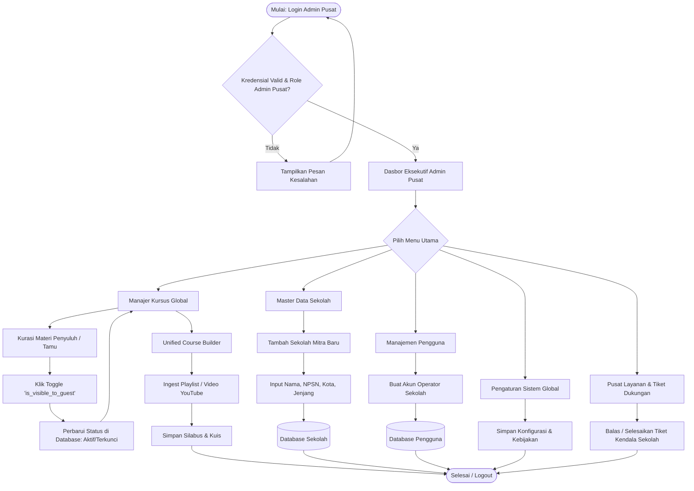
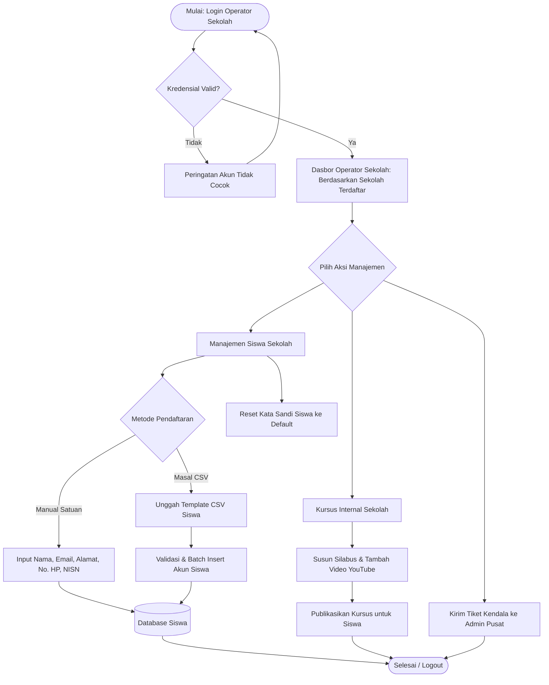
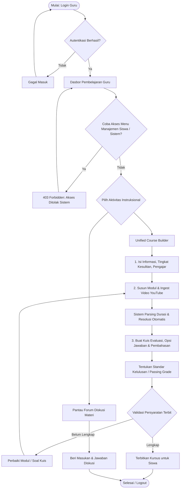
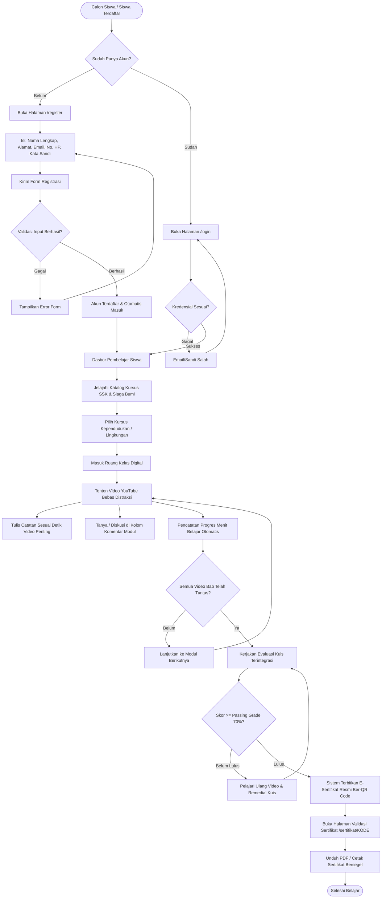
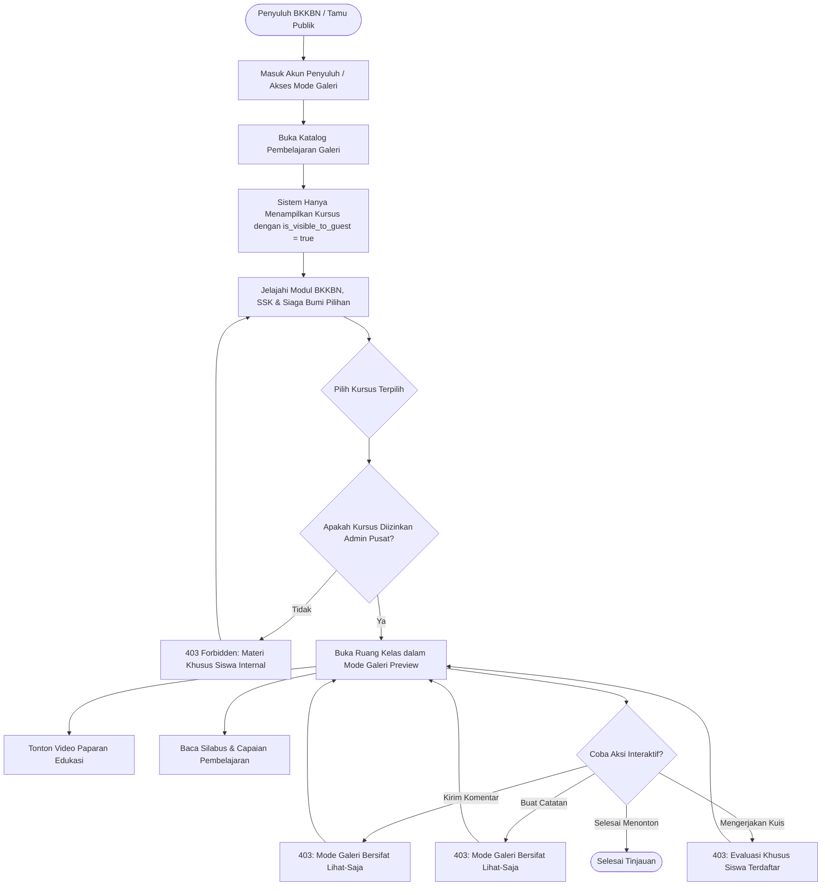

# ALUR PENGGUNA & FLOWCHART SISTEM SIAGA BUMI-SSK
## (Sekolah Siaga Kependudukan & Lingkungan Hidup)

Dokumen ini memuat diagram alur komprehensif (*Mermaid.js Flowcharts*) dan arsitektur akses berbasis peran (*Role-Based Access Control / RBAC*) untuk aplikasi **SIAGA BUMI-SSK LMS**.

---

## 1. Arsitektur Matriks Hak Akses (5 Peran Pengguna)

| Modul / Fitur | Admin Pusat (`admin_pusat`) | Operator Sekolah (`operator_sekolah`) | Guru (`guru`) | Siswa (`siswa`) | Penyuluh / Tamu (`penyuluh`) |
| :--- | :---: | :---: | :---: | :---: | :---: |
| **Katalog Materi Terbuka** | ✅ Penuh | ✅ Penuh | ✅ Penuh | ✅ Penuh | ✅ Materi Terkurasi Saja |
| **Pendaftaran Mandiri (Register)** | — | — | — | ✅ Mandiri | — |
| **Pemutar Video & Materi (Classroom)** | ✅ Penuh | ✅ Penuh | ✅ Penuh | ✅ Penuh | 👁️ Pratinjau (Lihat-Saja) |
| **Catatan Pribadi & Diskusi** | ✅ Akses | ✅ Akses | ✅ Akses | ✅ Akses | ❌ Dibatasi (Read-Only) |
| **Kuis Evaluasi & Progres** | ✅ Akses | ✅ Akses | ✅ Akses | ✅ Mengerjakan | ❌ Dibatasi (Read-Only) |
| **Penerbitan Sertifikat Ber-QR** | ✅ Monitor | ✅ Monitor | ✅ Monitor | ✅ Unduh & Verifikasi | ❌ Dibatasi |
| **Course Builder & Ingest YouTube** | ✅ Semua Instansi | ✅ Instansi Sendiri | ✅ Instansi Sendiri | ❌ Dilarang | ❌ Dilarang |
| **Kurasi Visibilitas Tamu (`is_visible_to_guest`)**| ✅ Penuh (Eksklusif)| ❌ Dilarang | ❌ Dilarang | ❌ Dilarang | ❌ Dilarang |
| **Manajemen Siswa (CRUD / Import CSV)** | ✅ Semua Instansi | ✅ Instansi Sendiri | ❌ Dilarang | ❌ Dilarang | ❌ Dilarang |
| **Master Sekolah & Akun Operator** | ✅ Penuh (Eksklusif)| ❌ Dilarang | ❌ Dilarang | ❌ Dilarang | ❌ Dilarang |
| **Pengaturan Global & Log Tiket** | ✅ Penuh (Eksklusif)| ❌ Tiket Mandiri | ❌ Tiket Mandiri | ❌ Dilarang | ❌ Dilarang |

---

## 2. Flowchart End-to-End per Peran Pengguna

### A. Flowchart: Admin Pusat (`admin_pusat`)
Admin Pusat memegang kendali tata kelola tertinggi platform, mengelola sekolah mitra (seperti SMP Negeri 1 Bitung dan SMA 44 Minahasa), memvalidasi akun operator, dan secara khusus mengurasi materi publik untuk peran Penyuluh/Tamu.

---

### B. Flowchart: Operator Sekolah (`operator_sekolah`)
Operator Sekolah mengelola operasional digital di tingkat satuan pendidikan, mendaftarkan dan memantau siswa, mereset kata sandi siswa, serta memonitor kurikulum sekolahnya.

---

### C. Flowchart: Guru (`guru` / Pendidik)
Guru berfokus murni pada perancangan kurikulum, pembuatan modul, pengunggahan materi video YouTube, pembuatan bank soal kuis, dan diskusi kelas. Guru **dibatasi secara ketat** dari menu manajemen pengguna dan setelan sistem.

---

### D. Flowchart: Siswa (`siswa` / Pembelajar)
Siswa dapat mendaftar secara mandiri melalui form registrasi baru (dengan nama lengkap, alamat, email, dan nomor HP), menjelajahi materi SSK, menonton video terstruktur, membuat catatan, mengerjakan kuis, dan mengunduh sertifikat kelulusan ber-QR Code.

---

### E. Flowchart: Penyuluh / Tamu (`penyuluh` / `guest`)
Peran Penyuluh dan Tamu difungsikan dalam **Mode Galeri (Lihat-Saja)** untuk meninjau materi sosialisasi BKKBN dan SSK yang telah dikurasi oleh Admin Pusat tanpa dapat mengubah data progres atau kuis.

---

## 3. Ringkasan Integritas Keamanan & Middleware

1. **`RoleMiddleware`**: Memeriksa token sesi terhadap hierarki peran pengguna (`admin_pusat`, `operator_sekolah`, `guru`, `siswa`, `penyuluh`).
2. **Scoping Multi-Tenancy**: Operator Sekolah dan Guru dibatasi hanya pada lingkup data sekolah mereka masing-masing (`school_name`).
3. **Guard Mode Galeri**: Seluruh endpoint mutasi (`storeNote`, `storeComment`, `toggleBookmark`, `toggleCompletion`, `saveProgress`, `submitQuiz`) mengeksekusi `abort(403)` jika diakses oleh akun `isGuestRole()`.
4. **Validasi QR Code Publik**: Halaman `/sertifikat/{code}` terbuka untuk pemindaian instan oleh masyarakat atau instansi guna memverifikasi keabsahan tanda kelulusan.
